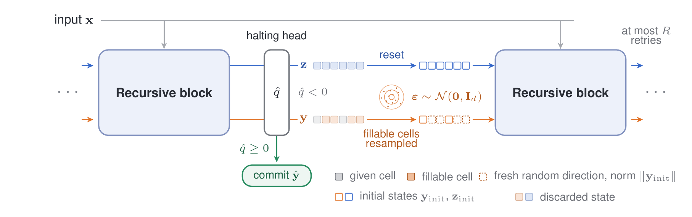
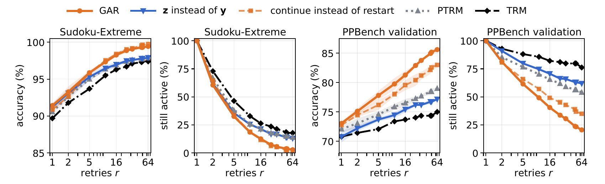
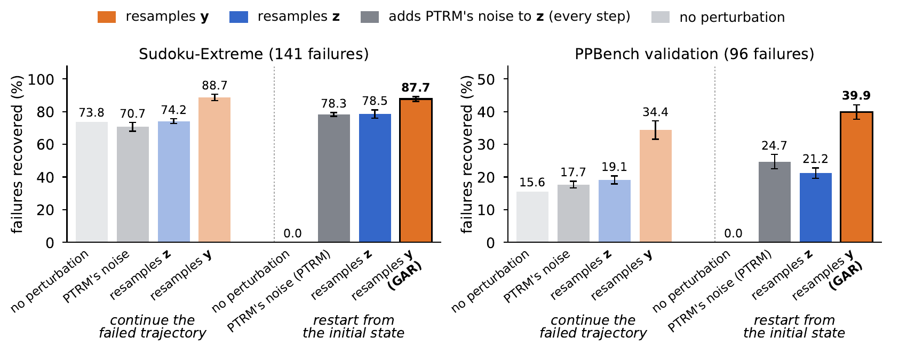

<div align="center">

# Resample the Answer: Where to Spend Test-Time Compute in Recursive Reasoning

**Maxime Illouz**<br>
Concordia University · Mila – Québec AI Institute

[](https://arxiv.org/abs/2610.16427)
[](https://huggingface.co/MaximeILL/GAR_ckpts)

</div>

This repository holds the code of the paper: seven notebooks for its experiments on Sudoku-Extreme and Pencil Puzzle Bench (PPBench). The two Tiny Recursive Model (TRM) checkpoints they evaluate are on the [Hugging Face Hub](https://huggingface.co/MaximeILL/GAR_ckpts).

**Gated Answer Resampling (GAR)** is a test-time compute method for TRM. When the model's own halting head rejects an answer, GAR restarts the recursion from the initial states with the fillable cells of the answer state resampled, and stops at the first answer that the head accepts, or after R retries. With R = 64 and no training or hyperparameter search, it takes TRM from 85.9% to 99.4% on Sudoku-Extreme and from 68.8% to 85.6% on PPBench validation, at 2.03 and 7.08 times the cost of a standard pass. On the same checkpoints, it outperforms Probabilistic TRM (PTRM), even when PTRM uses 42 to 197 times as much compute.

<p align="center">
  
</p>

*Figure 1 of the paper. The recursion runs in blocks of 16 supervision steps over a fast reasoning state **z** (blue) and a slow answer state **y** (orange). The first block is the standard pass. After each block, the grid ŷ is committed if the halting logit q̂, read from **y**, is non-negative. Otherwise a retry restarts from the initial states, except on the fillable cells of **y**, which receive fresh isotropic Gaussian directions rescaled to the norm of **y**<sub>init</sub>. If no grid is committed after R retries, the fallback returns the grid with the highest q̂.*

## Contents

- [Overview](#overview)
- [Results](#results)
- [Method](#method)
- [Using GAR on a TRM checkpoint](#using-gar-on-a-trm-checkpoint)
- [Repository](#repository)
- [Reproducing the paper](#reproducing-the-paper)
- [Training the checkpoints](#training-the-checkpoints)
- [Citation](#citation)
- [Acknowledgements](#acknowledgements)
- [License](#license)

## Overview

TRM refines two latent states: an answer state **y**, decoded into the output grid, and a reasoning state **z**, which is never decoded. In each latent recursion, **z** is recomputed six times from the input, the answer state and itself, after which **y** is updated once from **y** and **z**. The recursion is deterministic, so a rerun fails the same puzzles in exactly the same way. Recent test-time methods perturb **y**, **z** or both to recover these failures. The paper asks which state a retry should perturb, and whether extra compute should continue a failed trajectory (depth) or restart from the initial states (width).

Every method runs on the same checkpoints and puzzles, and the retries are compared inside one shared harness: after the standard pass, each puzzle that the halting head rejects receives up to R retries of 16 supervision steps, until the head accepts a grid. Only the retry changes. The main findings are:

1. **The answer state carries the failure.** After 16 retries that continue the failed trajectory, resampling **y** recovers 89% of the standard-pass failures on Sudoku-Extreme and 34% on PPBench validation, against 74% and 16% without perturbation and 74% and 19% when **z** is resampled. Restarts that resample **y** do as well (88% and 40%), and restarts are independent draws that can run in parallel.
2. **Test-time compute is better spent resampling y than perturbing z, increasingly so as the budget grows.** After 64 restarts, resampling **y** recovers 96% and 54% of the failures, against 85% and 27% when **z** is resampled instead and 85% and 33% for PTRM, which adds noise to **z** before every step.
3. **GAR is tuning-free and compute-efficient.** The halting head rejects 99.3% (Sudoku-Extreme) and 87.5% (PPBench validation) of the failures and none of the successes, so GAR loses no solved puzzle. PTRM stays below GAR at R = 64 even with 197 and 42 times as much compute under its own protocol.

## Results

### Main operating points

<table>
  <thead>
    <tr>
      <th rowspan="2" align="left">Method</th>
      <th colspan="3">Sudoku-Extreme</th>
      <th colspan="3">PPBench validation</th>
    </tr>
    <tr>
      <th align="right">cost</th><th align="right">accuracy (%)</th><th align="right">lost</th>
      <th align="right">cost</th><th align="right">accuracy (%)</th><th align="right">lost</th>
    </tr>
  </thead>
  <tbody>
    <tr><td>TRM, standard pass</td>
      <td align="right">1</td><td align="right">85.90</td><td align="right">–</td>
      <td align="right">1</td><td align="right">68.83</td><td align="right">–</td></tr>
    <tr><td>TRM, uniform unroll (D = 64 / 48)</td>
      <td align="right">4</td><td align="right">92.80</td><td align="right">0.0</td>
      <td align="right">3</td><td align="right">68.18</td><td align="right">10.0</td></tr>
    <tr><td>PTRM, own protocol (K′ = 25, D = 16)</td>
      <td align="right">25</td><td align="right">97.40</td><td align="right">1.0</td>
      <td align="right">25</td><td align="right">77.81</td><td align="right">1.0</td></tr>
    <tr><td>PTRM, own protocol (K′ = 100, D = 16)</td>
      <td align="right">100</td><td align="right">98.07</td><td align="right">0.3</td>
      <td align="right">100</td><td align="right">80.63</td><td align="right">1.3</td></tr>
    <tr><td>PTRM, own protocol (K′ = 100, D = 64 / 48) †</td>
      <td align="right">400</td><td align="right">98.57</td><td align="right">0.0</td>
      <td align="right">300</td><td align="right">79.98</td><td align="right">10.3</td></tr>
    <tr><td>PTRM under the harness (K′ = 100, D = 64 / 48) †</td>
      <td align="right">8.65</td><td align="right">98.47</td><td align="right">0.0</td>
      <td align="right">42.25</td><td align="right">82.14</td><td align="right">0.0</td></tr>
    <tr><td><b>GAR (R = 16)</b></td>
      <td align="right"><b>1.68</b></td><td align="right"><b>98.27</b></td><td align="right"><b>0.0</b></td>
      <td align="right"><b>3.48</b></td><td align="right"><b>81.28</b></td><td align="right"><b>0.0</b></td></tr>
    <tr><td><b>GAR (R = 64)</b></td>
      <td align="right"><b>2.03</b></td><td align="right"><b>99.43</b></td><td align="right"><b>0.0</b></td>
      <td align="right"><b>7.08</b></td><td align="right"><b>85.61</b></td><td align="right"><b>0.0</b></td></tr>
  </tbody>
</table>

Abridged from Table 2 of the paper, on the 1,000 Sudoku-Extreme test puzzles and the 308 PPBench validation puzzles of the five reported types. Cost is in blocks per puzzle, where one block is 16 supervision steps, the cost of a standard pass. *Lost* counts the puzzles that the standard pass solves and the method fails, out of 859 and 212. Stochastic rows are means over three sampling seeds on the same checkpoint, and the standard deviation of their accuracy is at most 0.46 points on Sudoku-Extreme and 0.75 on PPBench. PTRM is rerun on our checkpoints, with σ = 0.3 on Sudoku-Extreme and σ* = 1.5 on PPBench ([Method](#method) explains this choice). With its own protocol, it draws K = 100 noisy rollouts of D steps for every puzzle and returns the grid with the highest q̂ among the first K′ (best-Q@K′); under the harness, the same rollouts run one at a time, as retries. The uniform unroll runs the recursion for D steps on every puzzle. † PTRM's headline budget: 197 and 42 times the cost of GAR at R = 64 with its own protocol, and 4.3 and 6.0 times under the harness.

### Matched numbers of retries

<table>
  <thead>
    <tr>
      <th rowspan="2" align="left">Method</th>
      <th colspan="2">Sudoku-Extreme</th>
      <th colspan="2">PPBench validation</th>
    </tr>
    <tr>
      <th>16 retries</th><th>64 retries</th>
      <th>16 retries</th><th>64 retries</th>
    </tr>
  </thead>
  <tbody>
    <tr><td>TRM under the harness (depth alone)</td>
      <td align="center">96.30 (1.97)</td><td align="center">97.40 (3.33)</td>
      <td align="center">73.70 (4.79)</td><td align="center">75.00 (15.20)</td></tr>
    <tr><td>PTRM (one rollout of 16 steps per retry)</td>
      <td align="center">96.93 ± 0.15 (1.82)</td><td align="center">97.87 ± 0.06 (2.90)</td>
      <td align="center">76.52 ± 0.68 (4.25)</td><td align="center">79.00 ± 0.19 (11.86)</td></tr>
    <tr><td><b>GAR</b></td>
      <td align="center"><b>98.27 ± 0.21 (1.68)</b></td><td align="center"><b>99.43 ± 0.15 (2.03)</b></td>
      <td align="center"><b>81.28 ± 0.68 (3.48)</b></td><td align="center"><b>85.61 ± 0.37 (7.08)</b></td></tr>
    <tr><td>&nbsp;&nbsp;&nbsp;↳ <b>z</b> instead of <b>y</b></td>
      <td align="center">96.97 ± 0.35 (1.80)</td><td align="center">97.90 ± 0.00 (2.84)</td>
      <td align="center">75.43 ± 0.50 (4.42)</td><td align="center">77.16 ± 0.19 (12.92)</td></tr>
    <tr><td>&nbsp;&nbsp;&nbsp;↳ continue instead of restart</td>
      <td align="center">98.40 ± 0.26 (1.69)</td><td align="center">99.73 ± 0.06 (1.98)</td>
      <td align="center">79.55 ± 0.86 (3.73)</td><td align="center">83.01 ± 0.50 (9.06)</td></tr>
  </tbody>
</table>

Accuracy (%, ± standard deviation over three seeds) and cost in blocks per puzzle (in parentheses). The standard pass scores 85.90% and 68.83%. Each indented row changes one thing in GAR, and PTRM differs from "**z** instead of **y**" only in how **z** is perturbed (Table 1 of the paper).

Continuing instead of restarting gains 0.30 points on Sudoku-Extreme at 64 retries but loses 2.60 on PPBench validation, so GAR restarts. Table 11 of the paper gives seven budgets from r = 1 to 64 and the golden split, and Table 12 the paired differences with their bootstrap intervals.

<p align="center">
  
</p>

*Figure 4 of the paper. Accuracy after r retries, and fraction of the re-opened puzzles still active (no grid accepted) before the r-th retry; mean ± standard deviation over three seeds. TRM continues without perturbation (depth alone), and each PTRM retry is one rollout of D = 16 steps.*

### Which state to perturb

<p align="center">
  
</p>

*Figure 2 of the paper. Fraction of the standard-pass failures that end up correct after 16 retries, out of 141 on Sudoku-Extreme and 96 on PPBench validation. In each panel, retries continue the failed trajectory on the left (depth) and restart from the initial state on the right (width). A restart without perturbation replays the standard pass and recovers nothing. Mean ± standard deviation over three seeds.*

### Limitations

GAR inherits the halting head of the model: the gate misses 12.5% of the PPBench validation failures, and the head can accept wrong grids on retries. On the PPBench golden split (the same 49 puzzles as in PTRM, 33 of them solved by the standard pass), the gate also re-opens one solved puzzle, and GAR loses it. GAR has not been tested on Maze-Hard, where this head is poorly aligned, on ARC-AGI, or beyond TRM. On PPBench, its gains are smallest on nurikabe and heyawake, and the checkpoint is trained on a reconstruction of PTRM's data pipeline.

## Method

### The shared harness

TRM keeps two states of shape [P + L, d]: a prefix of P = 16 positions, the L grid cells, and width d = 512. A supervision step runs T = 3 latent recursions, each made of n = 6 updates of **z** followed by one update of **y**. The halting head reads the first prefix position of **y** and outputs the halting logit q̂. At evaluation, the N<sub>sup</sub> = 16 supervision steps all run: this is one *block*. The *standard pass* is one block from (**y**<sub>init</sub>, **z**<sub>init</sub>), the model's fixed initial states, and all costs are counted in blocks per puzzle. Under the harness:

- **Gate.** If q̂ ≥ 0 at the end of the standard pass, the grid is committed and nothing else runs. Otherwise the puzzle is re-opened.
- **Retries.** A re-opened puzzle runs retries, one block at a time, at most R of them.
- **Stopping rule.** The first retry with q̂ ≥ 0 ends the search, and its grid is committed.
- **Fallback.** If no retry is accepted, the harness returns the grid with the highest q̂ among the standard pass and the retries.

A solved puzzle can be lost only if the gate re-opens it. The two budgets, R = 16 (= N<sub>sup</sub>) and R = 64, were fixed in advance. Since the random draws of a retry do not depend on R, the first r retries of a run form a run with R = r.

### Retries and GAR

A retry either *continues* the failed trajectory from where the previous block left it (depth), or *restarts* from (**y**<sub>init</sub>, **z**<sub>init</sub>) (width). It applies no perturbation, *resamples* one state, or, as in PTRM, adds noise 𝒩(0, σ²I) to **z** before every supervision step. To resample a state, the vector of each fillable cell is replaced, once at the block boundary, by a fresh direction drawn from an isotropic Gaussian and rescaled to the norm of that state's initial value. GAR restarts and resamples **y**:

```text
Algorithm 1: Gated Answer Resampling
Input: puzzle x, a trained TRM, T_blk = N_sup = 16, budget R (16 by default), halting threshold 0

1  y, z, grid, q = BLOCK(x, y_init, z_init)           # the standard 16-step pass
2  best_grid, best_q = grid, q                        # fallback on the halting logit
3  for r = 1, ..., R:
4      if q >= 0: return best_grid                    # the gate at r = 1, then the stopping rule
5      y, z = y_init, z_init                          # restart: nothing crosses the boundary
6      for every fillable cell i in M(x):             # prefix and given cells untouched
           y[i] = ||y_init|| * e_i / ||e_i||,  e_i ~ N(0, I_d)
7      y, z, grid, q = BLOCK(x, y, z)
8      if q > best_q: best_grid, best_q = grid, q
9  end for
10 return best_grid
```

BLOCK runs T<sub>blk</sub> supervision steps and returns the new states, the grid ŷ and the last halting logit q̂ (`grid` and `q` above); it never reads a label. The main retries of the paper differ from Algorithm 1 as follows, and Table 10 lists further continued retries, which perturb **z** or both states:

| Retry | Change to Algorithm 1 |
|:---|:---|
| continue instead of restart (the *continuation variant* of GAR) | skip line 5 |
| TRM under the harness (depth alone) | skip lines 5 and 6 |
| restart without perturbation (a control, which replays the standard pass bit for bit) | skip line 6 |
| **z** instead of **y** | resample **z** instead of **y** in line 6 |
| PTRM under the harness | skip line 6, and in line 7 run one rollout of D steps with noise added to **z** before every step (D = 16 at matched numbers of retries) |

**Fillable cells.** On Sudoku-Extreme, the fillable cells M(x) are the blank cells. PPBench has no blank token, since each token encodes the whole visible state of a cell, so the *static* clue families, whose answer is fixed by the input, are declared once per puzzle type: the given digits on sudoku, the walls on lightup and shakashaka, the numbered cells on nurikabe and the clue cells on tapa. Heyawake has none, because its numbers belong to rooms and a numbered cell can be shaded. The fillable cells are those whose token is neither the pad token nor in a static family, so the mask reads only the input.

**Nothing to tune.** The block length and the default R come from the training horizon, the threshold from the halting rule, the norm from **y**<sub>init</sub>, and the mask from the input tokens. The only free parameter is the budget R. Labels of the reported splits did inform two design decisions: the choice of retry, made on Sudoku-Extreme and PPBench validation, and the static families of each PPBench type, which were checked against the labels of its validation and golden splits.

**The PTRM baseline.** PTRM's checkpoints were not publicly available, so every method, PTRM included, runs on our checkpoints. On Sudoku-Extreme, σ = 0.3 is PTRM's value. On PPBench, σ* = 1.5 lies inside the plateau of best-Q@25 in a sweep on our validation split, so it is selected on the labels of the split we report; PTRM's value there, 0.2, scores 2.70 points lower, and the best scale of the grid, 2.5 at its edge, 0.65 points higher (Table 6).

Section 3 of the paper describes the protocol and its statistics, and Appendices A and C give the details.

## Using GAR on a TRM checkpoint

The notebooks run the retries with their full bookkeeping: caches, controls and statistics. The code below is GAR alone, written against TRM's model code: the `models/` package of the [TRM release](https://github.com/SamsungSAILMontreal/TinyRecursiveModels), which every notebook clones at commit `c011037`. It performs the same writes to the two states as the notebooks' `restart` arm, and draws the same directions from a given generator.

```python
import torch
import yaml

from models.losses import ACTLossHead
from models.recursive_reasoning.trm import TinyRecursiveReasoningModel_ACTV1


def load_trm(ckpt_path, config_path, vocab_size, seq_len, device="cuda"):
    """Builds TRM from its all_config.yaml and loads a checkpoint, as the notebooks do."""
    arch = dict(yaml.safe_load(open(config_path))["arch"])
    loss_type = arch.pop("loss")["loss_type"]
    arch.pop("name", None)
    state = torch.load(ckpt_path, map_location=device)
    # A checkpoint saved from a compiled model prefixes its keys with "_orig_mod."
    state = {k.replace("_orig_mod.", "", 1): v for k, v in state.items()}
    n_ids = state["model.inner.puzzle_emb.weights"].shape[0]
    config = dict(arch, batch_size=768, vocab_size=vocab_size, seq_len=seq_len,
                  num_puzzle_identifiers=n_ids)
    with torch.device(device):
        model = ACTLossHead(TinyRecursiveReasoningModel_ACTV1(config), loss_type=loss_type)
    model.load_state_dict(state, assign=True)  # strict: the keys must match exactly
    return model.eval().model  # the ACT wrapper; in eval mode, every block runs all its steps


@torch.no_grad()
def run_block(net, batch, carry):
    """One block of supervision steps: the new carry, the grids and the last halting logits."""
    for _ in range(net.config.halt_max_steps):  # 16 steps, after which every row halts
        carry, out = net(carry=carry, batch=batch)
    return carry, out["logits"].argmax(-1), out["q_halt_logits"].float()


@torch.no_grad()
def gar(net, batch, fillable, R=16, generator=None):
    """Gated Answer Resampling (Algorithm 1) on a batch of puzzles.

    net:      TRM's ACT wrapper in eval mode (load_trm above)
    batch:    dict with "inputs" [B, L] and "puzzle_identifiers" [B], on the model's device
    fillable: bool tensor [B, L], True on the cells that the input does not fix
    Returns the committed grids [B, L]. Every block runs on the whole batch, and the outputs
    of the rows already committed are ignored. Padding rows (PAD token 0) are never re-opened.
    """
    assert not net.training
    inner, P = net.inner, net.inner.puzzle_emb_len
    with torch.device(batch["inputs"].device):
        carry = net.initial_carry(batch)  # rows start "halted": step 1 loads y_init, z_init
    carry, best, q = run_block(net, batch, carry)          # the standard pass
    best_q = q.clone()
    active = (q < 0) & (batch["inputs"] != 0).any(-1)      # the gate; padding rows stay closed
    norm_y = inner.H_init.float().norm()                   # ||y_init||
    for _ in range(R):
        if not active.any():
            break
        y, z = carry.inner_carry.z_H, carry.inner_carry.z_L  # answer state, reasoning state
        rows = active.view(-1, 1, 1)
        eps = torch.randn(y[:, P:].shape, generator=generator, device=y.device)
        eps = eps / eps.norm(dim=-1, keepdim=True).clamp_min(1e-9) * norm_y
        y.copy_(torch.where(rows, inner.H_init.to(y.dtype), y))   # restart y, prefix included
        cells = (fillable & active.view(-1, 1)).unsqueeze(-1)
        y[:, P:] = torch.where(cells, eps.to(y.dtype), y[:, P:])  # resample its fillable cells
        z.copy_(torch.where(rows, inner.L_init.to(z.dtype), z))   # restart z
        carry.halted.fill_(False)
        carry.steps.zero_()
        carry, pred, q = run_block(net, batch, carry)             # one retry
        better = active & (q > best_q)                            # the fallback keeps the best q
        best = torch.where(better.view(-1, 1), pred, best)
        best_q = torch.where(better, q, best_q)
        active &= q < 0                                           # the stopping rule
    return best
```

On Sudoku-Extreme, token 1 is the blank cell:

```python
import torch
from huggingface_hub import hf_hub_download

ckpt = hf_hub_download("MaximeILL/GAR_ckpts", "TRM-MLP-Sudoku-Extreme.pt")
config = hf_hub_download("MaximeILL/GAR_ckpts", "TRM-MLP-Sudoku-Extreme.yaml")
net = load_trm(ckpt, config, vocab_size=11, seq_len=81)

# batch: a test batch of TRM's PuzzleDataset on the GPU (keys "inputs", "puzzle_identifiers", ...)
grids = gar(net, batch, fillable=batch["inputs"] == 1, R=64,
            generator=torch.Generator("cuda").manual_seed(0))
```

On PPBench (`TRM-Att-PPBench.pt`, `vocab_size=439`, `seq_len=100`), the fillable cells come from the vocabulary of the dataset build:

```python
import ast
import json

import torch

STATIC_FAMILIES = {"sudoku": {"g"}, "lightup": {"wall"}, "shakashaka": {"wall"},
                   "nurikabe": {"n"}, "tapa": {"c"}, "heyawake": set()}


def ppbench_fillable_ids(vocab_path):
    """Ids of the cell states whose clue family is not static for their puzzle type."""
    ids = []
    for key, token_id in json.load(open(vocab_path)).items():
        cell = ast.literal_eval(key)  # (puzzle type, clue, answer mark, ...)
        ptype, clue = cell[0], cell[1]
        family = clue[0] if isinstance(clue, tuple) and len(clue) else str(clue)
        if family not in STATIC_FAMILIES.get(ptype, set()):
            ids.append(int(token_id))
    return torch.tensor(sorted(ids))


fillable_ids = ppbench_fillable_ids("data/ppbench-6type/vocab.json").to(batch["inputs"])
grids = gar(net, batch, fillable=torch.isin(batch["inputs"], fillable_ids), R=64)
```

The model forward runs in bfloat16, and the paper's evaluations ran on A100 GPUs with batches of 768. See [Running the notebooks](#running-the-notebooks) before comparing results at the level of single puzzles.

## Repository

```text
.
├── SudokuExtreme_continue_and_PTRM.ipynb   # Sudoku-Extreme: continued retries and PTRM
├── SudokuExtreme_GAR.ipynb                 # Sudoku-Extreme: GAR at R = 64
├── SudokuExtreme_z_instead_of_y.ipynb      # Sudoku-Extreme: the restart that resamples z
├── PPBench_data_and_training.ipynb         # PPBench: dataset build and training
├── PPBench_continue_and_PTRM.ipynb         # PPBench: continued retries and PTRM
├── PPBench_GAR.ipynb                       # PPBench: GAR at R = 64
├── PPBench_z_instead_of_y.ipynb            # PPBench: the restart that resamples z
├── assets/                                 # figures of this README
├── LICENSE                                 # MIT license of this repository
├── LICENSE_TRM                             # MIT license of TRM, which the notebooks clone and patch
└── README.md
```

Each notebook clones the [TRM release](https://github.com/SamsungSAILMontreal/TinyRecursiveModels) at commit `c011037` and uses its model, loss and data loader. The six evaluation notebooks mount Google Drive, where they read the checkpoints and keep their caches, and return their results as pandas tables (on Sudoku-Extreme, the standard pass and the gate are printed).

| Notebook | What it runs | Results |
|:---|:---|:---|
| [`SudokuExtreme_continue_and_PTRM`](SudokuExtreme_continue_and_PTRM.ipynb) | Builds Sudoku-Extreme and draws the 1,000 test puzzles. Evaluates the standard pass and the gate, eight kinds of continued retry at R = 16 with three seeds and the restart without perturbation (one retry, a control), and PTRM rerun on the checkpoint: σ = 0.3, K = 100 rollouts of D = 16 and 64 steps, three seeds, with its own protocol and under the harness, and the uniform unroll. | `LATTICE`, `PTRM_OWN`, `PTRM_HARNESS` |
| [`SudokuExtreme_GAR`](SudokuExtreme_GAR.ipynb) | GAR and its continuation variant at R = 64 with three seeds, against TRM and PTRM under the harness, with paired bootstrap intervals. | `TABLE`, `RECOVERED`, `SOLVED_BY_ONE` |
| [`SudokuExtreme_z_instead_of_y`](SudokuExtreme_z_instead_of_y.ipynb) | The restart that resamples **z** instead of **y**, at R = 64, against GAR and PTRM. | `TABLE`, `RECOVERED`, `SOLVED_BY_ONE` |
| [`PPBench_data_and_training`](PPBench_data_and_training.ipynb) | Builds the six-type PPBench dataset, checks it, and trains TRM-Att. | the dataset, the counts per type, the checkpoints |
| [`PPBench_continue_and_PTRM`](PPBench_continue_and_PTRM.ipynb) | On validation and golden: the standard pass and the gate, continued retries at R = 16 and the restart without perturbation (one retry, a control), PTRM rerun on the checkpoint (σ* = 1.5, K = 100, D = 16 and 48) with its own protocol and under the harness, and the uniform unroll. On validation only: PTRM's noise in continued retries at five scales, and the σ sweep. | `GATE`, `LATTICE`, `DOSE`, `PTRM_OWN`, `PTRM_HARNESS`, `SIGMA_SWEEP` |
| [`PPBench_GAR`](PPBench_GAR.ipynb) | GAR and its continuation variant at R = 64 on validation and golden, against TRM and PTRM under the harness, with paired intervals and results per type. | `TABLES` |
| [`PPBench_z_instead_of_y`](PPBench_z_instead_of_y.ipynb) | The restart that resamples **z** instead of **y**, at R = 64, on validation and golden. | `TABLES` |

## Reproducing the paper

### Requirements

- A Google Colab runtime with an NVIDIA A100 GPU and Google Drive. Outside Colab, the Drive mount is skipped, and the paths of the configuration cell must point to local folders.
- The first cell installs `einops`, `pydantic`, `argdantic`, `tqdm` and `huggingface_hub` in the Sudoku-Extreme notebooks, and `einops`, `pydantic` and `argdantic` in the PPBench evaluation notebooks. `PPBench_data_and_training` installs the dependencies of TRM's training code (`einops`, `tqdm`, `coolname`, `pydantic`, `argdantic`, `wandb`, run offline, `omegaconf`, `hydra-core`, `huggingface_hub`, `numba`), `ppbench==0.1.0`, which ships the pzprjs puzzle engine and the golden puzzles, and, if they are missing, PyTorch (CUDA 12.1 build) and Node.js.
- TRM-Att was trained at batch 768 on an A100 80GB. On a smaller GPU, `PPBench_data_and_training` lets you halve the batch, which departs from the paper's recipe.

### Checkpoints and data

The two checkpoints are on the Hugging Face Hub, at [`MaximeILL/GAR_ckpts`](https://huggingface.co/MaximeILL/GAR_ckpts). Each one is the last checkpoint of its training run and holds the EMA weights, and comes with a `.yaml` file of the same name: the `all_config.yaml` that TRM's training code writes next to its checkpoints.

| Checkpoint | Model | Parameters | Size | Standard pass |
|:---|:---|---:|---:|:---|
| `TRM-MLP-Sudoku-Extreme.pt` | TRM-MLP | 5.03M | 20.1 MB | 85.90% on the 1,000 test puzzles, 86.50% on the full test split |
| `TRM-Att-PPBench.pt` | TRM-Att | 7.27M | 29.1 MB | 68.83% on validation, 67.35% on golden (five types) |

The notebooks expect the layout of TRM's training code, a checkpoint file `step_<N>` with `all_config.yaml` in the same folder. On Colab, with the default paths of the notebooks:

```python
import os
import shutil

from google.colab import drive
from huggingface_hub import hf_hub_download

drive.mount("/content/drive")
ROOT = "/content/drive/MyDrive/GAR"
for name, folder, step in [("TRM-MLP-Sudoku-Extreme", f"{ROOT}/sudoku/checkpoints", 65100),
                           ("TRM-Att-PPBench", f"{ROOT}/ppbench/checkpoints", 254961)]:
    os.makedirs(folder, exist_ok=True)
    shutil.copy(hf_hub_download("MaximeILL/GAR_ckpts", f"{name}.pt"), f"{folder}/step_{step}")
    shutil.copy(hf_hub_download("MaximeILL/GAR_ckpts", f"{name}.yaml"), f"{folder}/all_config.yaml")
```

The configuration cell of each evaluation notebook sets `CKPT_TRM`, the checkpoint file, and `CACHE_DIR`, the folder of its caches, which the notebooks of a benchmark share.

- **Sudoku-Extreme.** The notebooks build the data in the session with TRM's `dataset/build_sudoku_dataset.py`, from the Hugging Face dataset `sapientinc/sudoku-extreme`. The 1,000 evaluation puzzles are drawn from the 422,786 test puzzles, uniformly without replacement, with seed 0.
- **PPBench.** `DATA_PATH` is the dataset built by `PPBench_data_and_training`, from revision `3ac6add0754f1458bf51aab160ca039667a67b38` of the corpus `bluecoconut/pencil-puzzle-bench`, `ppbench==0.1.0` and seed 0. That notebook builds it in `/content/TRM/data/ppbench-6type` and does not mount Drive: mount Drive in that session (`from google.colab import drive; drive.mount("/content/drive")`), then copy the dataset to `DATA_PATH` (by default `/content/drive/MyDrive/GAR/ppbench/data/ppbench-6type`) with `shutil.copytree`.

### Running the notebooks

On each benchmark, run `*_continue_and_PTRM` first: it writes PTRM's rollouts, which `*_GAR` and `*_z_instead_of_y` read. Then run `*_GAR`, which runs GAR (pass `RST064`), its continuation variant (pass `R064`) and TRM under the harness (pass `R064none`), and `*_z_instead_of_y`, which runs the restart that resamples **z** (pass `MIR064`) and reads GAR's passes from the cache, or runs them if they are missing. On PPBench, build the dataset with `PPBench_data_and_training` before anything else.

Each pass and each set of PTRM rollouts is saved under `CACHE_DIR` as an `.npz` file and reloaded when a notebook runs again: when all its files are in the cache, a notebook runs only the standard pass and its checks, and builds its tables from the files. Before using a file, the notebooks check that the standard pass it was computed with matches, bit for bit, the one they compute themselves: they compare the halting logits and grids of all puzzles for a PPBench pass file, the halting logits of all puzzles for a PPBench rollout file, and the halting logits of the first batch of 768 puzzles on Sudoku-Extreme. Results computed on another GPU or software version may differ on single puzzles, so a file that fails this check stops the notebook, and deleting it makes the notebook that writes it compute it again (`*_continue_and_PTRM` for PTRM's rollouts). The paper's results on the 1,000 Sudoku-Extreme test puzzles were computed in eager mode and its PPBench results under `torch.compile`, all on A100 GPUs.

The notebooks also run the checks of Appendices A and C of the paper: a restart that resamples nothing replays the standard pass bit for bit; without noise, a PTRM rollout of 16 steps reproduces the standard pass, and a longer one reproduces continued blocks; and on PPBench, the fillable cells read from the input contain every cell whose label differs from the input and no unlabelled cell. `*_continue_and_PTRM` also prints the norms of Appendix A: positions output by the network have norm √d = 22.627, and resampled directions are rescaled to ‖**y**<sub>init</sub>‖ = 21.244 or ‖**z**<sub>init</sub>‖ = 22.689.

### Where each result comes from

In this table, `*_` stands for the `SudokuExtreme_` and `PPBench_` notebooks. On PPBench, every table except `DOSE` and `SIGMA_SWEEP` (validation only) is given per split (`"val"` or `"gold"`), and `TABLE`, `RECOVERED` and `SOLVED_BY_ONE` are the entries `"table"`, `"recovered"` and `"solved_by_one"` of `TABLES[split]`, which also holds the results per type (`"per_type"`).

| In the paper | Notebooks and tables |
|:---|:---|
| Table 1, Table 11 and Figure 4: matched retries | `*_GAR` (`TABLE`: GAR, continue instead of restart, TRM, PTRM, with the fraction of re-opened puzzles still active), `*_z_instead_of_y` (`TABLE`: **z** instead of **y**) |
| Table 2: main operating points | `*_continue_and_PTRM` (standard pass: printed on Sudoku-Extreme, `GATE` on PPBench; uniform unroll and PTRM with its own protocol: `PTRM_OWN`; PTRM under the harness: `PTRM_HARNESS`, which loses nothing since the gate re-opens no success on these splits), `*_GAR` (`TABLE`, `RECOVERED`: GAR rows) |
| Table 3: the gate | `*_continue_and_PTRM` (printed on Sudoku-Extreme, `GATE` on PPBench) |
| Table 4, the PPBench column of Table 5, Appendix B.2: PPBench data and training | `PPBench_data_and_training` |
| Table 6: σ sweep | `PPBench_continue_and_PTRM` (`SIGMA_SWEEP`) |
| Tables 7 and 8: PTRM configurations | `*_continue_and_PTRM` (`PTRM_OWN`, `PTRM_HARNESS`) |
| Table 9 and Figure 2: which state to perturb | `*_continue_and_PTRM` (`LATTICE`), `*_GAR` (`RECOVERED`: GAR, PTRM), `*_z_instead_of_y` (`RECOVERED`) |
| Table 10 and Appendix D.1: continued retries in detail, noise doses | `*_continue_and_PTRM` (`LATTICE`; `DOSE` on PPBench) |
| Table 12: paired differences | `*_GAR` (`TABLE`: continue minus GAR, GAR minus PTRM), `*_z_instead_of_y` (`TABLE`: **y** minus **z**, once minus noise) |
| Tables 14 to 16: PPBench per type, golden split | `PPBench_GAR` (`TABLES`: golden split, and per type GAR, continue instead of restart and PTRM), `PPBench_z_instead_of_y` (`TABLES`: golden split, and per type), `PPBench_continue_and_PTRM` (golden: `GATE`, `LATTICE`, `PTRM_OWN`) |

### Not included in this release

- The resets of **z** on Sudoku-Extreme in Table 10.
- The lockstep diagnostic of Table 13 and Appendix F.
- The plotting code of Figures 2 to 4 and the projection of Figure 3. The notebooks compute every value that Figures 2 and 4 plot.
- The Sudoku-Extreme training run, which uses the TRM release command given [below](#training-the-checkpoints).

### Names in the code

| In the paper | In the notebooks |
|:---|:---|
| answer state **y**, reasoning state **z** | `z_H`, `z_L` (in `carry.inner_carry`); initial states `inner.H_init`, `inner.L_init` |
| GAR | arm `restart`, pass `RST064` |
| continue instead of restart (continuation variant) | arm `randvec`, pass `R064` |
| **z** instead of **y** | arm `restart_mirror`, pass `MIR064` |
| TRM under the harness (depth alone) | arm `none`, pass `R064none` |
| restart without perturbation (control) | arm `cold` |
| PTRM's noise in continued retries | arm `zvec` (σ = 0.3 on Sudoku-Extreme, 1.5 on PPBench); `dose_s{σ:.2f}` for the doses (PPBench only) |
| continued retries that resample **z** on the fillable cells / on all cells | arms `randz` / `randz_all` |
| continued retries that reset **z** to **z**<sub>init</sub> (fillable cells / all cells / all positions) | arms `zinit_cells` / `zinit_all` / `zinit_full` (PPBench only) |
| continued retries that resample **y** and perturb **z** | arms `randvec_zvec`, `randvec_randz`, `randvec_zinit_*` (the last on PPBench only) |
| deterministic reset of **y** to **y**<sub>init</sub> on the fillable cells | arm `retract` |
| PTRM | `rollout`, `ptrm`; rollout files `TRM__K{K}_D{D}_s{σ:.2f}__seed{s}.npz`, and `TRM__sweep_s{σ:.2f}__seed{s}.npz` for the σ sweep (in `CACHE_DIR/ptrm/` on PPBench) |
| fillable cells | `fill` (the blank token on Sudoku-Extreme; `fillable` on PPBench, from `STATIC_FAMILIES`) |
| block, retry budget, halting threshold | `T` (16 supervision steps), `ROUNDS`, `Q_THR = 0.0` |

## Training the checkpoints

Both checkpoints use the model, loss, data loader and training loop of the TRM release, with AdamW in place of its AdamATan2 optimizer. Each was trained on a single A100 80GB.

| | Sudoku-Extreme | PPBench |
|:---|:---|:---|
| Model | TRM-MLP (MLP across the 97 positions), no positional encoding | TRM-Att (self-attention, 8 heads), RoPE |
| Shared architecture | 2 layers, width 512, channel SwiGLU width 1,536; T = 3, n = 6, N<sub>sup</sub> = 16; prefix P = 16; bfloat16 forward | same |
| Puzzle identifiers, vocabulary, cells | 1, 11, 81 | 7 (six types and blank), 439, 100 |
| Loss | stablemax cross-entropy + 0.5 × halting BCE, halting exploration 0.1 | same |
| Optimizers | AdamW, β = (0.9, 0.95), weight decay 1.0; sign-SGD for the puzzle embeddings, decay 1.0 | same |
| Learning rate, batch, EMA | 10⁻⁴ with 2,000 warm-up steps, then constant; 768; 0.999 | same |
| Training set, epochs | 1,000 puzzles × 1,001 examples, 50,000 epochs | 9,325 puzzles × 11 examples, 21,000 epochs |

**Sudoku-Extreme.** The checkpoint comes from the released TRM-MLP command, which trains for 50,000 epochs (the TRM paper reports 60,000), and is the last of the run:

```bash
git clone https://github.com/SamsungSAILMontreal/TinyRecursiveModels && cd TinyRecursiveModels
git checkout c011037
# install PyTorch as in the TRM README, then its requirements without adam-atan2 (AdamW replaces it)
sed -i '/adam-atan2/d' requirements.txt && pip install -r requirements.txt
sed -i 's/from adam_atan2 import AdamATan2/from torch.optim import AdamW as AdamATan2/' pretrain.py
python dataset/build_sudoku_dataset.py --output-dir data/sudoku-extreme-1k-aug-1000 \
  --subsample-size 1000 --num-aug 1000
python pretrain.py arch=trm data_paths="[data/sudoku-extreme-1k-aug-1000]" evaluators="[]" \
  epochs=50000 eval_interval=5000 lr=1e-4 puzzle_emb_lr=1e-4 \
  weight_decay=1.0 puzzle_emb_weight_decay=1.0 \
  arch.mlp_t=True arch.pos_encodings=none arch.L_layers=2 arch.H_cycles=3 arch.L_cycles=6 ema=True
```

The released script draws the 1,000 training puzzles without a fixed seed, so a new run trains on a different subset. The paper's checkpoint reaches 86.50% on the full test split, against 87.4% reported in the TRM paper.

**PPBench.** `PPBench_data_and_training` reconstructs PTRM's data pipeline, which its paper describes in prose (its Appendix A.3), from the full PPBench corpus (62,231 puzzles). It removes the 90 golden puzzles of the six types, draws 100 validation puzzles per type (50 for tapa) with seed 0, keeps 9×9 sudoku and 10×10 grids of the other types, and expands each training puzzle into 11 examples: the original pair and 10 boards after the first k moves of the solution, each under a random dihedral transform. Each cell is one token encoding its full visible state (vocabulary of 439). Training then runs TRM's training script, patched to use AdamW and to log the aggregate of each split over the five reported types (`ppbench.patch`, in the notebook):

```bash
python pretrain.py arch=trm data_paths="[data/ppbench-6type]" evaluators="[]" \
  +report_types="[sudoku,lightup,nurikabe,heyawake,tapa]" \
  global_batch_size=768 epochs=21000 eval_interval=1000 lr=1e-4 puzzle_emb_lr=1e-4 \
  weight_decay=1.0 puzzle_emb_weight_decay=1.0 \
  arch.mlp_t=False arch.pos_encodings=rope arch.L_layers=2 arch.H_cycles=3 arch.L_cycles=6 ema=True
```

The paper's checkpoint is the last of the 21 evaluations, which is also the best on the validation aggregate. As in PTRM, shakashaka is used in training and left out of the aggregates; the checkpoint solves 64 of its 66 validation puzzles and all 12 golden ones.

## Citation

```bibtex
@misc{illouz2026resample,
  title         = {Resample the Answer: Where to Spend Test-Time Compute in Recursive Reasoning},
  author        = {Illouz, Maxime},
  year          = {2026},
  eprint        = {2610.16427},
  archivePrefix = {arXiv},
  primaryClass  = {cs.LG},
  url           = {https://arxiv.org/abs/2610.16427}
}
```

## Acknowledgements

Maxime Illouz is a PhD student funded by bursaries from Canada Research Chair grant number CRC-2023-00228 (*Computing for the Greater Good*) awarded to Elvis Dohmatob. The notebooks build on the TRM release of Samsung SAIL Montréal, and the PPBench build relies on the `ppbench` package and the PPBench dataset.

Questions and bug reports are welcome as GitHub issues, or by email at maxime.illouz@mila.quebec.

## License

The code of this repository and the checkpoints are released under the MIT License: see [`LICENSE`](LICENSE). The notebooks clone TRM, © 2025 Samsung Electronics Co., Ltd., also under the MIT License, and `PPBench_data_and_training` patches its training script: see [`LICENSE_TRM`](LICENSE_TRM).
