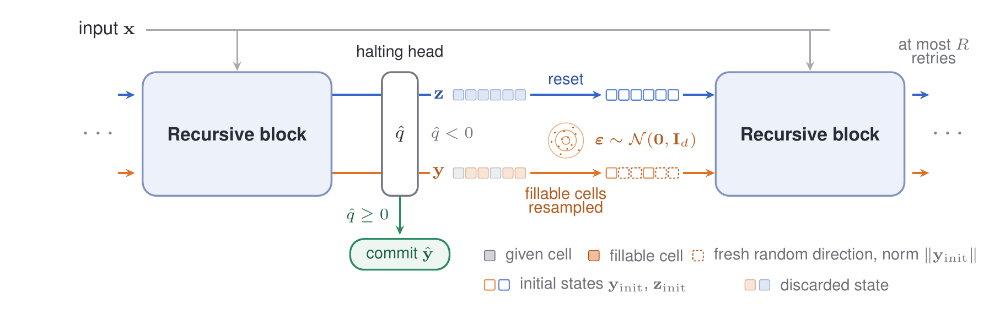

<div align="center">

# Resample the Answer: Where to Spend Test-Time Compute in Recursive Reasoning

**Maxime Illouz**<br>
Concordia University · Mila – Québec AI Institute

[](https://arxiv.org/abs/2610.16427)
[](https://huggingface.co/MaximeILL/GAR_ckpts)

</div>

This repository holds the code of the paper: seven notebooks for its experiments on Sudoku-Extreme and Pencil Puzzle Bench (PPBench). The two Tiny Recursive Model (TRM) checkpoints they evaluate are on the [Hugging Face Hub](https://huggingface.co/MaximeILL/GAR_ckpts).

**Gated Answer Resampling (GAR)** is a test-time compute method for TRM. When the model's own halting head rejects an answer, GAR restarts the recursion from the initial states with the fillable cells of the answer state resampled, and stops at the first answer that the head accepts, or after R retries. With R = 64 and no training or hyperparameter search, it takes TRM from 85.9% to 99.4% on Sudoku-Extreme and from 68.8% to 85.6% on PPBench validation, at 2.03 and 7.08 times the cost of a standard pass. On the same checkpoints, it outperforms Probabilistic TRM (PTRM), even when PTRM uses 42 to 197 times as much compute.

<p align="center">
  
</p>

## Using GAR on a TRM checkpoint

The code below is GAR alone, without the caches, controls and statistics of the notebooks. It is written against the `models/` package of the [TRM release](https://github.com/SamsungSAILMontreal/TinyRecursiveModels) at commit `c011037`, performs the same writes to the two states as the notebooks' `restart` arm, and draws the same directions from a given generator.

<details>
<summary>Implementation: <code>load_trm</code>, <code>run_block</code> and <code>gar</code></summary>

```python
import torch
import yaml

from models.losses import ACTLossHead
from models.recursive_reasoning.trm import TinyRecursiveReasoningModel_ACTV1


def load_trm(ckpt_path, config_path, vocab_size, seq_len, device="cuda"):
    """Builds TRM from its all_config.yaml and loads a checkpoint, as the notebooks do."""
    arch = dict(yaml.safe_load(open(config_path))["arch"])
    loss_type = arch.pop("loss")["loss_type"]
    arch.pop("name", None)
    state = torch.load(ckpt_path, map_location=device)
    # A checkpoint saved from a compiled model prefixes its keys with "_orig_mod."
    state = {k.replace("_orig_mod.", "", 1): v for k, v in state.items()}
    n_ids = state["model.inner.puzzle_emb.weights"].shape[0]
    config = dict(arch, batch_size=768, vocab_size=vocab_size, seq_len=seq_len,
                  num_puzzle_identifiers=n_ids)
    with torch.device(device):
        model = ACTLossHead(TinyRecursiveReasoningModel_ACTV1(config), loss_type=loss_type)
    model.load_state_dict(state, assign=True)  # strict: the keys must match exactly
    return model.eval().model  # the ACT wrapper; in eval mode, every block runs all its steps


@torch.no_grad()
def run_block(net, batch, carry):
    """One block of supervision steps: the new carry, the grids and the last halting logits."""
    for _ in range(net.config.halt_max_steps):  # 16 steps, after which every row halts
        carry, out = net(carry=carry, batch=batch)
    return carry, out["logits"].argmax(-1), out["q_halt_logits"].float()


@torch.no_grad()
def gar(net, batch, fillable, R=16, generator=None):
    """Gated Answer Resampling (Algorithm 1) on a batch of puzzles.

    net:      TRM's ACT wrapper in eval mode (load_trm above)
    batch:    dict with "inputs" [B, L] and "puzzle_identifiers" [B], on the model's device
    fillable: bool tensor [B, L], True on the cells that the input does not fix
    Returns the committed grids [B, L]. Every block runs on the whole batch, and the outputs
    of the rows already committed are ignored. Padding rows (PAD token 0) are never re-opened.
    """
    assert not net.training
    inner, P = net.inner, net.inner.puzzle_emb_len
    with torch.device(batch["inputs"].device):
        carry = net.initial_carry(batch)  # rows start "halted": step 1 loads y_init, z_init
    carry, best, q = run_block(net, batch, carry)          # the standard pass
    best_q = q.clone()
    active = (q < 0) & (batch["inputs"] != 0).any(-1)      # the gate; padding rows stay closed
    norm_y = inner.H_init.float().norm()                   # ||y_init||
    for _ in range(R):
        if not active.any():
            break
        y, z = carry.inner_carry.z_H, carry.inner_carry.z_L  # answer state, reasoning state
        rows = active.view(-1, 1, 1)
        eps = torch.randn(y[:, P:].shape, generator=generator, device=y.device)
        eps = eps / eps.norm(dim=-1, keepdim=True).clamp_min(1e-9) * norm_y
        y.copy_(torch.where(rows, inner.H_init.to(y.dtype), y))   # restart y, prefix included
        cells = (fillable & active.view(-1, 1)).unsqueeze(-1)
        y[:, P:] = torch.where(cells, eps.to(y.dtype), y[:, P:])  # resample its fillable cells
        z.copy_(torch.where(rows, inner.L_init.to(z.dtype), z))   # restart z
        carry.halted.fill_(False)
        carry.steps.zero_()
        carry, pred, q = run_block(net, batch, carry)             # one retry
        better = active & (q > best_q)                            # the fallback keeps the best q
        best = torch.where(better.view(-1, 1), pred, best)
        best_q = torch.where(better, q, best_q)
        active &= q < 0                                           # the stopping rule
    return best
```

</details>

On Sudoku-Extreme, token 1 is the blank cell:

```python
import torch
from huggingface_hub import hf_hub_download

ckpt = hf_hub_download("MaximeILL/GAR_ckpts", "TRM-MLP-Sudoku-Extreme.pt")
config = hf_hub_download("MaximeILL/GAR_ckpts", "TRM-MLP-Sudoku-Extreme.yaml")
net = load_trm(ckpt, config, vocab_size=11, seq_len=81)

# batch: a test batch of TRM's PuzzleDataset on the GPU (keys "inputs", "puzzle_identifiers", ...)
grids = gar(net, batch, fillable=batch["inputs"] == 1, R=64,
            generator=torch.Generator("cuda").manual_seed(0))
```

On PPBench (`TRM-Att-PPBench.pt`, `vocab_size=439`, `seq_len=100`), the fillable cells come from the vocabulary of the dataset build:

```python
import ast
import json

import torch

STATIC_FAMILIES = {"sudoku": {"g"}, "lightup": {"wall"}, "shakashaka": {"wall"},
                   "nurikabe": {"n"}, "tapa": {"c"}, "heyawake": set()}


def ppbench_fillable_ids(vocab_path):
    """Ids of the cell states whose clue family is not static for their puzzle type."""
    ids = []
    for key, token_id in json.load(open(vocab_path)).items():
        cell = ast.literal_eval(key)  # (puzzle type, clue, answer mark, ...)
        ptype, clue = cell[0], cell[1]
        family = clue[0] if isinstance(clue, tuple) and len(clue) else str(clue)
        if family not in STATIC_FAMILIES.get(ptype, set()):
            ids.append(int(token_id))
    return torch.tensor(sorted(ids))


fillable_ids = ppbench_fillable_ids("data/ppbench-6type/vocab.json").to(batch["inputs"])
grids = gar(net, batch, fillable=torch.isin(batch["inputs"], fillable_ids), R=64)
```

## Reproducing the paper

The notebooks run on Google Colab with an NVIDIA A100 GPU and Google Drive, where the evaluation notebooks read the checkpoints and keep their caches. Their first cell installs what they need on top of Colab's default environment, and each clones TRM at the commit above. Outside Colab, the Drive mount is skipped, and the paths of the configuration cell must point to local folders.

| Notebooks | What they run | In the paper |
|:---|:---|:---|
| [`PPBench_data_and_training`](PPBench_data_and_training.ipynb) | Builds the six-type PPBench dataset, checks it, and trains TRM-Att | Table 4, the PPBench column of Table 5, Appendix B.2 |
| `*_continue_and_PTRM` ([Sudoku-Extreme](SudokuExtreme_continue_and_PTRM.ipynb), [PPBench](PPBench_continue_and_PTRM.ipynb)) | The standard pass and the gate, continued retries at R = 16, PTRM rerun on the checkpoint, the uniform unroll; on PPBench, the σ sweep | Tables 2, 3 and 6 to 10, Figure 2 |
| `*_GAR` ([Sudoku-Extreme](SudokuExtreme_GAR.ipynb), [PPBench](PPBench_GAR.ipynb)) | GAR, its continuation variant and TRM under the harness, at R = 64 | Tables 1, 2, 9, 11 and 12, Figures 2 and 4 |
| `*_z_instead_of_y` ([Sudoku-Extreme](SudokuExtreme_z_instead_of_y.ipynb), [PPBench](PPBench_z_instead_of_y.ipynb)) | The restart that resamples **z** instead of **y**, at R = 64 | Tables 1, 9, 11 and 12, Figures 2 and 4 |

The PPBench evaluation notebooks also cover the golden split and the results per type (Tables 14 to 16). Not included in this release: the resets of **z** on Sudoku-Extreme in Table 10, the lockstep diagnostic of Table 13 and Appendix F, the projection of Figure 3, and the plotting code of Figures 2 to 4; the notebooks compute every value that Figures 2 and 4 plot.

### Checkpoints and data

The Hub holds `TRM-MLP-Sudoku-Extreme.pt` and `TRM-Att-PPBench.pt`, the last checkpoints of the two training runs, with their EMA weights. Each comes with a `.yaml` file of the same name, the `all_config.yaml` that TRM's training code writes next to its checkpoints. The notebooks expect the layout of TRM's training code, a checkpoint file `step_<N>` with `all_config.yaml` in the same folder. On Colab, with their default paths:

```python
import os
import shutil

from google.colab import drive
from huggingface_hub import hf_hub_download

drive.mount("/content/drive")
ROOT = "/content/drive/MyDrive/GAR"
for name, folder, step in [("TRM-MLP-Sudoku-Extreme", f"{ROOT}/sudoku/checkpoints", 65100),
                           ("TRM-Att-PPBench", f"{ROOT}/ppbench/checkpoints", 254961)]:
    os.makedirs(folder, exist_ok=True)
    shutil.copy(hf_hub_download("MaximeILL/GAR_ckpts", f"{name}.pt"), f"{folder}/step_{step}")
    shutil.copy(hf_hub_download("MaximeILL/GAR_ckpts", f"{name}.yaml"), f"{folder}/all_config.yaml")
```

The configuration cell of each evaluation notebook sets `CKPT_TRM`, the checkpoint file, and `CACHE_DIR`, the folder of its caches, which the notebooks of a benchmark share. The Sudoku-Extreme notebooks build their data in the session. On PPBench, `DATA_PATH` is the dataset built by `PPBench_data_and_training` in `/content/TRM/data/ppbench-6type`. That notebook does not mount Drive: mount Drive in that session (`from google.colab import drive; drive.mount("/content/drive")`), then copy the dataset to `DATA_PATH` (by default `/content/drive/MyDrive/GAR/ppbench/data/ppbench-6type`) with `shutil.copytree`.

### Running the notebooks

On each benchmark, run `*_continue_and_PTRM` first: it writes PTRM's rollouts, which `*_GAR` and `*_z_instead_of_y` read. On PPBench, build the dataset with `PPBench_data_and_training` before anything else.

Each pass and each set of PTRM rollouts is saved under `CACHE_DIR` as an `.npz` file and reloaded when a notebook runs again, after a check that the standard pass it was computed with matches, bit for bit, the one the notebook computes itself. Results computed on another GPU or software version may differ on single puzzles, so a file that fails this check stops the notebook, and deleting it makes the notebook that writes it compute it again. The paper's results on the 1,000 Sudoku-Extreme test puzzles were computed in eager mode and its PPBench results under `torch.compile`, all on A100 GPUs.

<details>
<summary>Names in the code</summary>

| In the paper | In the notebooks |
|:---|:---|
| answer state **y**, reasoning state **z** | `z_H`, `z_L` (in `carry.inner_carry`); initial states `inner.H_init`, `inner.L_init` |
| GAR | arm `restart`, pass `RST064` |
| continue instead of restart (continuation variant) | arm `randvec`, pass `R064` |
| **z** instead of **y** | arm `restart_mirror`, pass `MIR064` |
| TRM under the harness (depth alone) | arm `none`, pass `R064none` |
| restart without perturbation (control) | arm `cold` |
| PTRM's noise in continued retries | arm `zvec` (σ = 0.3 on Sudoku-Extreme, 1.5 on PPBench); `dose_s{σ:.2f}` for the doses (PPBench only) |
| continued retries that resample **z** on the fillable cells / on all cells | arms `randz` / `randz_all` |
| continued retries that reset **z** to **z**<sub>init</sub> (fillable cells / all cells / all positions) | arms `zinit_cells` / `zinit_all` / `zinit_full` (PPBench only) |
| continued retries that resample **y** and perturb **z** | arms `randvec_zvec`, `randvec_randz`, `randvec_zinit_*` (the last on PPBench only) |
| deterministic reset of **y** to **y**<sub>init</sub> on the fillable cells | arm `retract` |
| PTRM | `rollout`, `ptrm`; rollout files `TRM__K{K}_D{D}_s{σ:.2f}__seed{s}.npz`, and `TRM__sweep_s{σ:.2f}__seed{s}.npz` for the σ sweep (in `CACHE_DIR/ptrm/` on PPBench) |
| fillable cells | `fill` (the blank token on Sudoku-Extreme; `fillable` on PPBench, from `STATIC_FAMILIES`) |
| block, retry budget, halting threshold | `T` (16 supervision steps), `ROUNDS`, `Q_THR = 0.0` |

</details>

## Training the checkpoints

Table 5 and Appendix B of the paper give the configuration of both runs and the build of their data.

**Sudoku-Extreme.** The checkpoint is the last of a run of the released TRM-MLP command, with AdamW in place of AdamATan2:

```bash
git clone https://github.com/SamsungSAILMontreal/TinyRecursiveModels && cd TinyRecursiveModels
git checkout c011037
# install PyTorch as in the TRM README, then its requirements without adam-atan2 (AdamW replaces it)
sed -i '/adam-atan2/d' requirements.txt && pip install -r requirements.txt
sed -i 's/from adam_atan2 import AdamATan2/from torch.optim import AdamW as AdamATan2/' pretrain.py
python dataset/build_sudoku_dataset.py --output-dir data/sudoku-extreme-1k-aug-1000 \
  --subsample-size 1000 --num-aug 1000
python pretrain.py arch=trm data_paths="[data/sudoku-extreme-1k-aug-1000]" evaluators="[]" \
  epochs=50000 eval_interval=5000 lr=1e-4 puzzle_emb_lr=1e-4 \
  weight_decay=1.0 puzzle_emb_weight_decay=1.0 \
  arch.mlp_t=True arch.pos_encodings=none arch.L_layers=2 arch.H_cycles=3 arch.L_cycles=6 ema=True
```

The released script draws the 1,000 training puzzles without a fixed seed, so a new run trains on a different subset.

**PPBench.** `PPBench_data_and_training` builds the dataset and trains TRM-Att, with the same optimizer change. TRM-Att was trained at batch 768 on an A100 80GB; on a smaller GPU, the notebook lets you halve the batch, which departs from the paper's recipe.

## Citation

```bibtex
@misc{illouz2026resample,
  title         = {Resample the Answer: Where to Spend Test-Time Compute in Recursive Reasoning},
  author        = {Illouz, Maxime},
  year          = {2026},
  eprint        = {2610.16427},
  archivePrefix = {arXiv},
  primaryClass  = {cs.LG},
  url           = {https://arxiv.org/abs/2610.16427}
}
```

## Acknowledgements

Maxime Illouz is a PhD student funded by bursaries from Canada Research Chair grant number CRC-2023-00228 (*Computing for the Greater Good*) awarded to Elvis Dohmatob.

Questions and bug reports are welcome as GitHub issues, or by email at maxime.illouz@mila.quebec.

## License

The code of this repository and the checkpoints are released under the MIT License: see [`LICENSE`](LICENSE). The notebooks clone TRM, © 2025 Samsung Electronics Co., Ltd., also under the MIT License, and `PPBench_data_and_training` patches its training script: see [`LICENSE_TRM`](LICENSE_TRM).
